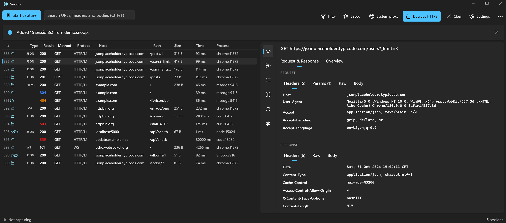
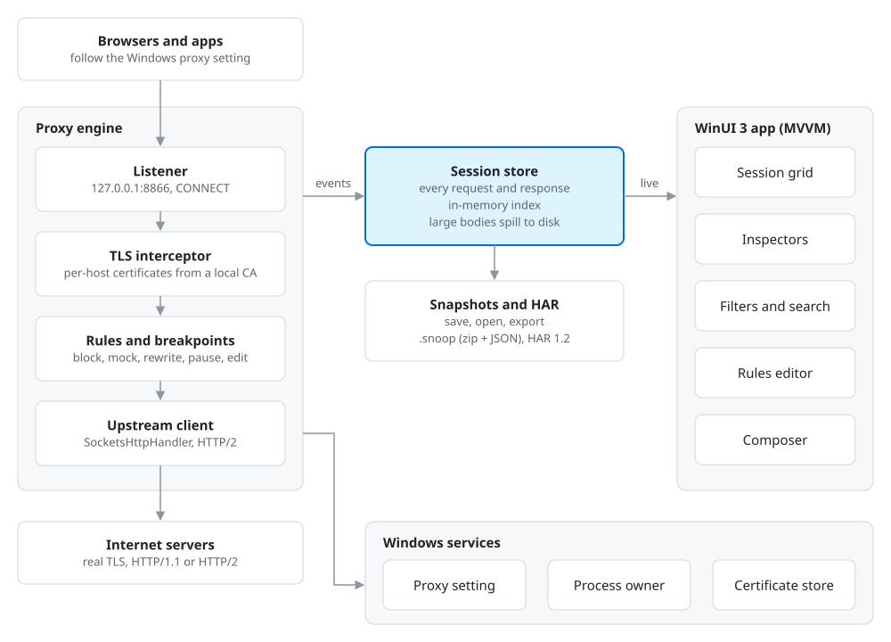

# Snoop

Snoop is a Windows tool for watching, debugging and changing the HTTP and HTTPS traffic of the apps
on your PC. It runs a local intercepting proxy, decrypts HTTPS with a root certificate it creates for
your machine, and shows every request and response as it happens. It comes as a desktop app
(`Snoop.exe`, WinUI 3) and a command-line tool (`snoop.exe`).



To look around without capturing anything, open [`docs/demo.snoop`](docs/demo.snoop) with Ctrl+O: 15 sample
sessions with JSON, HTML, an image, cache hits and errors, a WebSocket, a rule-answered request and a Composer request.

## The desktop app

```powershell
dotnet run --project src/Snoop.App
```

The window has three parts: a toolbar, the session list on the left and a details pane on the right
(drag the divider between them to resize).

**Toolbar.** Start/Stop capture and the search box are always in front (search matches URL, headers,
status, process and text bodies; every word must match; matches are highlighted in the list and the
headers; Enter selects the next match, Shift+Enter the previous; Ctrl+F). Then:

- **Filter:** hide tunnels, hide images/CSS/fonts, errors only, only the selected session's host or app
  (shown as a chip next to the search box; click it to show everything), search inside bodies, scroll
  to new sessions.
- **Saved:** name the current search and filters, and apply them again later.
- **System proxy** and **Decrypt HTTPS:** on/off buttons that show their state.
- **Clear** and **Settings** (opens the Settings dialog).
- **…** (more): new Composer request, save snapshots, open a snapshot or a HAR file (Ctrl+S / Ctrl+O),
  export HAR (optionally with secrets redacted) or plain text.

Snoop starts capturing on launch and makes itself the system proxy (both configurable). The original
proxy setting is restored when the window closes, on a crash, or at next start.

**Session list.** Number, type (JSON, HTML, JS, IMG...), result, method, protocol, host, path, size, time
and process. Results are coloured (errors red, client errors amber, redirects blue); secondary columns
are dimmed. Small icons after the number mark sessions that were paused, answered by a rule, changed,
sent from the Composer or opened from a file (hover for details). Ctrl+click and Shift+click select
several sessions; Ctrl+A selects all. Click a header to sort (again to
reverse, a third time for arrival order), drag a header edge to resize, right-click the header to show or
hide columns. When the list is empty it says why and what to do.

Right-click a session: copy URL / cURL / PowerShell, Send again, Edit in Composer, Auto-respond with this response,
show only this host or app, export the selected sessions (HAR, text or snapshot),
Mark for compare / Compare with marked, Don't decrypt this host, Remove (Del). You can also drag a
session onto the details pane to open it in the Composer.

**Details pane** (tabs):

- **Inspect:** request and response, each with Headers, Params (request), Raw and Body. Bodies are
  decoded (gzip, deflate, brotli) and shown as pretty JSON, indented XML, text, hex or an image.
- **Overview:** timings, TLS details, process, errors, and what changed the session (rule, breakpoint
  edit) with the original request.
- **WebSocket** (shown for WebSocket sessions): every message, sent ↑ and received ↓, with
  permessage-deflate undone; the selected message in full (pretty JSON, text or hex).
- **Composer:** write a request (or start from a captured one), send it with Send or Ctrl+Enter, see the
  response. It goes through Snoop, so it is captured and rules and breakpoints apply to it.
  - **Paste a cURL command** into the URL box (or use … → Import cURL) to fill in the method, URL,
    headers and body; bash and Windows cmd forms from browser developer tools both work. … → Copy as
    cURL goes the other way.
  - **Headers table** with a tick per header (unticked ones are kept but not sent), or "Edit as text"
    (one `Name: value` per line; `# ` at the start turns a header off).
  - **Saved requests** in the left pane, with folders; right-click to rename, duplicate or delete.
    Stored as one JSON file per request in `%APPDATA%\Snoop\requests\`.
  - **Variables:** write `{{baseUrl}}/users` or `Bearer {{token}}` anywhere in the request; values come
    from the environment picked at the top (… → Variables and environments). Built in: `{{$guid}}`,
    `{{$timestamp}}`, `{{$isoTimestamp}}`, `{{$randomInt}}`. Saved in `%APPDATA%\Snoop\environments.json`.
- **Rules:** when a request's URL matches (contains / wildcard / regex / exact, optionally one method),
  run actions in order: respond with text or a file (mock an API), delay, block, rewrite the URL (point
  production at localhost), set or remove request/response headers, or pause at a breakpoint. Rules
  apply as you type and are saved to `%APPDATA%\Snoop\rules.json`; the command line uses them too
  (without the breakpoint actions).
- **Breakpoints:** pause every request and/or response (optionally only URLs containing some text), or
  just the ones a rule picks. Edit the start line, headers and body (compressed bodies are shown
  decompressed), then Resume, Abort or Resume all.
- **Timeline:** a waterfall of the shown requests (send · wait for first byte · receive); click a bar to
  select that session.
- **Compare:** a line diff of two sessions' requests and responses, bodies decoded and pretty-printed.

**Settings** (dialog): port, start-up, system proxy, localhost, other devices, HTTPS decryption, skip
lists, zstd avoidance, root certificate (trust, remove, save as .cer), column reset. Saved in
`%APPDATA%\Snoop\settings.json`.

**Snapshots** (`.snoop`) are zip files with every captured byte; opening one adds its sessions to the
list. **HAR 1.2** files (from browser developer tools and most HTTP tools) open the same way; export can
redact secrets (Authorization, cookies, token-like query values). **Text export** writes each request
and response as readable text, with compressed bodies decoded.

**zstd:** .NET has no zstd decoder, so by default Snoop removes `zstd` from `Accept-Encoding` and
servers answer with gzip or brotli instead (turn it off in Settings, or with `--keep-zstd`).

A banner offers to trust the Snoop root certificate when HTTPS decryption needs it.

## Keyboard shortcuts

Shortcuts also appear next to their menu items and in tooltips.

**Anywhere in the window**

| Keys | Does |
| --- | --- |
| Ctrl+F | Go to the search box |
| F3 / Shift+F3 | Select the next / previous shown session (the next search match) |
| Ctrl+1 … Ctrl+6 | Open a tool: Inspect, Composer, Rules, Breakpoints, Timeline, Compare |
| Ctrl+S | Save the shown sessions as a snapshot (in the Composer: save the request) |
| Ctrl+O | Open a snapshot or a HAR file |
| Ctrl+L | Clear the session list |
| Ctrl+R | Send the selected request(s) again, unchanged (needs capture running) |
| Ctrl+E | Edit the selected request in the Composer |
| Alt+← / Alt+→ | Back / forward through the sessions you have looked at |

Ctrl+L, Ctrl+R, Ctrl+E and Alt+arrows do nothing while you are typing in a text box.

**Search box**

| Keys | Does |
| --- | --- |
| Enter / Shift+Enter | Select the next / previous match |
| Esc | Clear the search; press again to go back to the list |

**Session list**

| Keys | Does |
| --- | --- |
| ↑ / ↓, Home / End | Move the selection |
| Ctrl+click, Shift+click, Ctrl+A | Select several sessions / all sessions |
| Ctrl+C | Copy the selected sessions' URLs |
| Ctrl+Shift+C | Copy the selected sessions as cURL commands |
| Delete | Remove the selected sessions |
| Double-click | Show the session in the inspector, whichever tool is open |
| Shift+F10 or the Menu key | Open the right-click menu |

**Composer**

| Keys | Does |
| --- | --- |
| Ctrl+Enter | Send the request |
| Ctrl+S | Save the request (asks for a name the first time) |

## What works today

- Local intercepting proxy on `127.0.0.1:8866`; if that port is busy, the next 10 are tried
- HTTP/1.0 and 1.1 from clients; HTTP/1.1 **and HTTP/2** to servers
- HTTPS decryption with a per-machine root certificate (RSA 2048, 10 years) and per-host
  ECDSA leaf certificates, minted on demand and cached
- Blind tunnels when decryption is off or for "do not decrypt" hosts
- Built-in skip list for apps that never accept a local root (Claude desktop, Google Drive, Windows Update)
- Automatic skip: when an app rejects Snoop's certificate twice in a row for a host, that host is no
  longer decrypted for the rest of the run, so the app recovers by itself
- WebSocket and other `Upgrade` connections relayed (handshake recorded, bytes counted)
- Request and response bodies recorded (in memory up to 256 KB, then spilled to temp files, 50 MB cap per body)
- Process name and ID for every local connection (Windows TCP table)
- Windows system proxy on/off, with a backup, crash recovery and a logon-time safety net
- Root key protected with DPAPI; one command to trust or untrust the root
- Built-in page at `http://127.0.0.1:8866/` with a root certificate download for other devices

## Requirements

- Windows 10 22H2 or Windows 11 (x64 or ARM64)
- [.NET 10 SDK](https://dotnet.microsoft.com/download/dotnet/10.0)

## Build, test, run

```powershell
dotnet build Snoop.slnx
dotnet test Snoop.slnx
dotnet run --project src/Snoop.App        # the desktop app (built separately, see below)

# One-time: trust the Snoop root certificate (Windows asks you to confirm)
dotnet run --project src/Snoop.Cli -- trust-root

# Capture everything on this PC until Ctrl+C
dotnet run --project src/Snoop.Cli -- run --system-proxy
```

The desktop app is excluded from `dotnet build/test Snoop.slnx`, so a XAML problem can never block the
tests. Build it on its own with `dotnet build src/Snoop.App` (add `-p:Platform=ARM64` on ARM PCs).

**Keyboard tests.** `tests/Snoop.App.UITests` starts the real `Snoop.exe` and presses every shortcut
(FlaUI, UI Automation). It runs the app with `--test`, so nothing is captured, the system proxy is not
touched and all data goes to a temporary folder; the demo snapshot is opened with `--open`. It needs
Windows and a desktop session (it takes the keyboard for a minute), so it is not part of `Snoop.slnx`:

```powershell
dotnet build src/Snoop.App -p:Platform=x64
dotnet test tests/Snoop.App.UITests
```

A separate check in `Snoop.Presentation.Tests` (runs everywhere) fails when a shortcut in the app and
the [Keyboard shortcuts](#keyboard-shortcuts) tables above disagree.

Publish a standalone `snoop.exe`:

```powershell
dotnet publish src/Snoop.Cli -c Release -r win-x64 --self-contained -o publish
```

## Command line

```
snoop [run] [options]       Start the proxy and print each request
snoop trust-root            Add the Snoop root certificate to your trusted roots
snoop untrust-root          Remove it again
snoop export-root <file>    Save the root certificate (.cer, or .pem for PEM text)
snoop reset-root            Delete the root certificate; a new one is made next start
snoop restore-proxy         Put back the system proxy setting saved by Snoop

Options for run:
  -p, --port <n>            Port to listen on (default 8866)
  -s, --system-proxy        Make Snoop the Windows system proxy while running
      --no-decrypt          Relay HTTPS without decrypting it
      --no-loopback         Do not capture localhost traffic via the system proxy
      --skip <host>         Never decrypt this host; repeatable; *.example.com allowed
      --no-default-skips    Also decrypt hosts on the built-in skip list
      --no-auto-skip        Keep decrypting hosts whose apps reject the Snoop certificate
      --keep-zstd           Leave zstd in Accept-Encoding (Snoop cannot show zstd bodies)
      --allow-remote        Listen on all interfaces (phones, other PCs)
      --show-tunnels        Also print CONNECT tunnel rows
  -v, --verbose / -q, --quiet
```

Sample output:

```
#1     200  GET     https://www.example.com/                 1.23 KB  84 ms  chrome:12044
#2     304  GET     https://www.example.com/app.js           0 B      21 ms  chrome:12044
#3     ERR  GET     http://localhost:5999/api                0 B      2 ms   node:8812
       Connection refused (localhost:5999)
```

## Safety: the system proxy is always put back

If Snoop leaves Windows pointing at a proxy that is not running, nothing can reach the internet.
So the original setting is saved to `%APPDATA%\Snoop\proxy-backup.json` **before** it is changed,
and it is restored:

1. when you press Ctrl+C or close the console window,
2. on an unhandled crash,
3. at the next start of Snoop, if the backup is still there,
4. at your next Windows logon, via a one-shot `RunOnce` entry (covers a hard kill),
5. manually, with `snoop restore-proxy`.

## How it works

All traffic flows through one local proxy; the app and the command line only read the recorded sessions.

<picture>
  <source media="(prefers-color-scheme: dark)" srcset="docs/architecture-dark.svg">
  
</picture>

## Project layout

```
Snoop.slnx
src/
  Snoop.Core/          Session model, header list, body capture, session store, snapshots, logging.
    Bodies/            CapturedBody (memory -> temp file spill), capture limits
    Http/              HttpHeader, HttpHeaderList (ordered, duplicates kept)
    Sessions/          Session, RequestInfo/ResponseInfo, timings, ISessionSink, SessionStore, SessionIdSource
    Snapshots/         SnapshotFile: .snoop save/load; HarFile: HAR import
    Diagnostics/       ISnoopLogger
    Formatting/        ByteSize
  Snoop.Proxy/         The engine. Cross-platform .NET; no NuGet packages.
    Http/              Head parser and writer, buffered connection stream, body streams, framing rules
    Engine/            ClientConnection (per-connection logic; .Interception.cs holds rules/breakpoints), local pages, errors
    Interception/      ITrafficInterceptor, editable messages, breakpoint controller
    WebSockets/        Frame parser and permessage-deflate decoder (watches the relay, changes nothing)
    Rules/             TrafficRule model, RuleSet (matching), RuleEngine (actions)
    Tls/               CertificateAuthority (root + leaf minting), encrypted on-disk store
    Upstream/          HTTP client to servers, raw TCP/TLS connector, bidirectional relay
    Processes/         IClientProcessResolver
    Util/              LRU cache, host pattern matcher
    ProxyServer.cs     Listener, accept loop, start/stop
  Snoop.Platform/      Windows-only pieces behind interfaces
    SystemProxy/       WinINET settings, backup/restore controller, RunOnce safety net
    Security/          DPAPI protector for the root key
    Certificates/      Trusted Root store install/remove
    Processes/         GetExtendedTcpTable process lookup
    Interop/           P/Invoke declarations
  Snoop.Hosting/       CaptureHost: one place that starts/stops capture, owns the session store, rules and
                       breakpoints, switches the system proxy and trusts the root. Used by the CLI and the app.
    Composer/          Sends Composer requests through the running proxy
    Rules/             rules.json load/save
  Snoop.Inspection/    Body decoding and formatting (JSON, XML, hex), raw messages, cURL/PowerShell (and cURL import),
                       HAR and text export, session filters (with body search), line diff. No UI code.
  Snoop.Presentation/  View models (MVVM) for the app, with no UI framework types, fully unit-tested.
    Editing/           Message <-> editable text (breakpoint editor, Composer)
    Composer/          Saved-request library, environments and {{variable}} filling
  Snoop.Cli/           Headless host: command-line parsing, console output, shutdown handling
  Snoop.App/           WinUI 3 desktop app: XAML views and thin Windows services (dispatcher,
                       clipboard, Save dialog). Builds on Windows only.
tests/
  Snoop.Core.Tests/       Header list, body capture, session store, formatting, snapshots
  Snoop.Proxy.Tests/      Parser, streams, framing, certificates, rules, plus end-to-end tests (including rules
                          and breakpoints) against local Kestrel servers
  Snoop.Platform.Tests/   System proxy controller (fake API), proxy settings
  Snoop.Hosting.Tests/    Capture host lifecycle, system proxy follow/restore, trust, skip host, Composer, rules file
  Snoop.Inspection.Tests/ Decoding, sniffing, formatting, cURL/PowerShell/HAR export, filters
  Snoop.Presentation.Tests/ Session grid, inspector, Composer, Rules, Breakpoints, snapshots, message editing,
                          and the README's keyboard shortcut tables against the app
  Snoop.App.UITests/      Presses every keyboard shortcut in the running app (Windows only; see above)
  Snoop.Cli.Tests/        Command-line parsing, session line formatting
```

## Design notes

- **Strict parsing where it matters.** Whitespace before a header colon, obsolete line folding,
  conflicting `Content-Length`, and `Transfer-Encoding` together with `Content-Length` are rejected
  with 400; these are classic request-smuggling vectors.
- **The server sees what the client sent.** No redirects followed, no decompression, no cookies,
  no tracing headers added. Hop-by-hop headers (`Connection`, `Proxy-*`, `Keep-Alive`, ...) are removed.
- **Bodies stream.** Bytes are forwarded as they arrive (server-sent events work) and recorded on the side.
- **TLS 1.3 note.** An app that rejects Snoop's certificate under TLS 1.3 does so after the handshake
  has completed on Snoop's side. Snoop flags such tunnels with a note ("no requests were sent through
  this tunnel...") rather than an error, because browsers also open spare connections they never use.
- **Not yet:** HTTP/2 from clients (Snoop offers only HTTP/1.1 via ALPN; browsers fall back),
  HTTP/3 (browsers fall back to TCP when a proxy is set), Firefox's own certificate store.

## Data locations

| What | Where |
| --- | --- |
| Root certificate (DPAPI-encrypted PFX) and public `.cer` | `%APPDATA%\Snoop\certificates\` |
| System proxy backup while active | `%APPDATA%\Snoop\proxy-backup.json` |
| Rules | `%APPDATA%\Snoop\rules.json` |
| App settings | `%APPDATA%\Snoop\settings.json` |
| Composer saved requests | `%APPDATA%\Snoop\requests\` (one `.json` per request, folders as sub-folders) |
| Composer variables and environments | `%APPDATA%\Snoop\environments.json` |
| Spilled bodies for the running capture | `%TEMP%\Snoop\` (swept at startup) |

## License

MIT. See [LICENSE](LICENSE).
